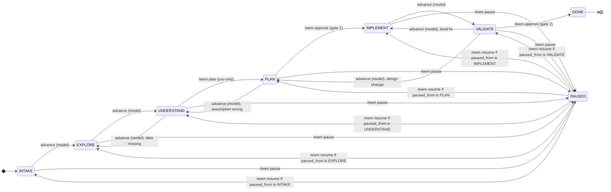

# ewm: Engineering Workflow Mod for Claude Code

ewm runs one engineering task as a resumable workflow: INTAKE, EXPLORE, UNDERSTAND, PLAN, IMPLEMENT, VALIDATE, DONE. Task state is stored in `.ewm/` in your repository, not in the conversation, so a task survives restarting Claude Code. Research is delegated to read-only subagents on a cheaper model, every finding must cite a file and line range, and two gates need your explicit `/ewm approve`: one before any edit, one before the task is closed. Use it when you want to agree on scope and a plan before code changes, and to see the evidence behind the change afterwards. v0.0.0 handles one active task in one repository.

## Install

```
/plugin install ewm --marketplace esola-thomas/claude_code_engineering_workflow_mod
```

Answer `y` when Claude Code asks to confirm, then choose a scope; user scope makes the plugin available in all your projects. The Desktop Code tab cannot run `/plugin`: install from a terminal at user scope, and the plugin then loads in the Desktop Code tab.

## Quickstart

Run Claude Code from the root of the repository you want to change. The mod pins that directory as the workspace for the session.

Optional, before step 1: create `.ewm/project.yaml` from [examples/project.yaml](examples/project.yaml) and set `validation.commands` to your real checks. The default profile has no validation commands, so VALIDATE cannot run anything.

1. **Start the task.** `/ewm new "Find why average() returns the wrong value"` creates TASK-001 in INTAKE. The lead proposes a goal, success criteria and constraints. Correct them in the conversation; the lead records them and moves to EXPLORE.
2. **Explore.** The lead delegates searches to `ewm:repo-scout` and `ewm:docs-scout` and records findings with path and line evidence. Check progress with `/ewm status`, the system map with `/ewm map`, and open questions with `/ewm questions`.
3. **Understand.** Ask the lead to explain the affected code. It stays in UNDERSTAND until you decide you are ready, then you run `/ewm plan`.
4. **Plan and approve.** The lead records the plan (steps, files, risks, tests, alternatives). Read it with `/ewm plan`. When it is right, run `/ewm approve`. The task moves to IMPLEMENT, where the lead may edit files.
5. **Validate.** When the steps are done, the lead moves to VALIDATE and runs the commands from `validation.commands` with `mcp__ewm__run_validation`, which records each exit code and output tail.
6. **Accept.** Run `/ewm approve` to accept closure. The task moves to DONE and `.ewm/tasks/TASK-001/handoff.md` lists the changed files, validation runs, decisions and open questions.

To stop at any point, run `/ewm pause`. In a new session, `/ewm resume TASK-001` restores the phase, decisions, approvals and open questions.

## Commands

| Command | Effect | Who can run it |
|---|---|---|
| `/ewm new "<title>" [--goal "<text>"]` | Start a task in INTAKE. A running task is paused first. | You |
| `/ewm resume [TASK-001]` | Continue the given task, else the active one, else the most recently updated open one. Prints a resume brief. | You |
| `/ewm status` | Phase, counts, models used, pending gate and next action. | Any |
| `/ewm map [--html]` | Draw the system map in the terminal (sized to its width; the links as a list when it does not fit) and switch the pane to Map. `--html` also writes `system-map.html` next to `system-map.md` and prints its `file://` link: one page with the diagram, the evidence each node cites, the links, notes and the Mermaid source. It loads nothing from the network and runs no script. | Any |
| `/ewm questions` | Show open and resolved questions, and switch the pane to Questions. | Any |
| `/ewm plan` | In UNDERSTAND, move to PLAN. In PLAN or later, show the plan. In INTAKE or EXPLORE, explain the path to PLAN. | You |
| `/ewm pause` | Save a checkpoint and leave the workflow. | You |
| `/ewm reset` | Save the gate ledger to `.ewm/ledger-backup-<time>.json` and start an empty one. Use it when the ledger is reported malformed, or to start over. Tasks on disk are kept; a task you resume afterwards starts at PLAN at most, with no approvals, so you approve its gates again. | You |
| `/ewm approve [--plan <hash>] [note]` | Approve the pending gate: in PLAN this moves to IMPLEMENT, in VALIDATE it moves to DONE. `--plan` refuses unless the plan still starts with that hash. | You |
| `/ewm reject <reason>` | Send the pending gate back with a reason. The task stays in its phase. | You |
| `/ewm list` | List tasks. | Any |
| `/ewm help` | Show the command list. | Any |

"You" means a human origin: a prompt you type or a headless run you start. The pane's Approve button also counts as you. The model and other plugins cannot change workflow state, so they cannot approve a gate.

## Workflow



- **advance (model)** edges are taken by the lead through `mcp__ewm__advance`. Only the edge from UNDERSTAND to PLAN is reserved for you.
- **Gate 1, plan approval (PLAN to IMPLEMENT).** Needs a plan with at least one step and your `/ewm approve`. The approval records the plan's hash. Editing the plan afterwards voids the approval, so you approve again. The gate is skipped when `policies.require_plan_approval` is `false`.
- **Gate 2, acceptance (VALIDATE to DONE).** Needs your `/ewm approve` and at least one passing `run_validation` run recorded since the task entered VALIDATE. Closing writes `handoff.md` and clears the active task.
- **Pause and resume.** `/ewm pause` works from any active phase. `/ewm resume` returns the task to the phase it was paused from. If that phase is IMPLEMENT or VALIDATE and the plan has no valid approval, the task resumes in PLAN. After `/ewm reset`, a task the ledger no longer knows resumes at PLAN at most with no approvals; a DONE task is not resumed.
- **Pane and status line.** The Engineering Workflow pane shows the phase, counts, models, next action and the buttons Overview, Map, Plan, Questions, Findings and Approve. Approve appears only while a gate waits for you. Plan, Questions and Findings are drawn as markdown. Map draws the system map: as a diagram (SVG, light or dark) in the desktop app, VS Code and mobile, and as box-drawing text sized to the pane in the terminal. A node whose evidence went stale is outlined in red (heavy box in the terminal), and in the desktop app hovering a node lists the findings that cite it. The status line shows the task, the phase and any pending gate. If the pane is not placed, the text output of each command is the fallback.

## Configuration

The profile is `.ewm/project.yaml`. If that file is absent, `.ewm/project.json` with the same keys is read. With neither, the defaults below apply. Edits take effect at the next `/ewm new` or `/ewm resume`; `/ewm resume` lists every field that changed. A wrong type falls back to the default with a warning, and an unknown key is ignored with a warning. The YAML reader accepts a subset: no anchors, tags, multi-line strings or flow maps. [schemas/project.schema.json](schemas/project.schema.json) is the JSON Schema of the profile.

| Key | Default | Meaning |
|---|---|---|
| `profile_id` | `default` | Short id stored on every task. |
| `name` | `Default` | Display name. |
| `repositories` | `["."]` | Repository roots. Recorded only; v0.0.0 works on one repository. |
| `domains` | `[]` | Business areas the project covers. Recorded only. |
| `entrypoints` | `["README.md", "docs/"]` | Where exploration starts. The explore stage reads it. |
| `policies.external_network` | `deny_by_default` | `deny_by_default` blocks web, outbound, third-party MCP and network commands while a task is active. `allow` lifts those rules. See [Security model](#security-model). |
| `policies.require_plan_approval` | `true` | `false` removes gate 1: the lead can then move from PLAN to IMPLEMENT without `/ewm approve`. |
| `policies.allow_write_in_explore` | `false` | `true` lets Edit and Write change the repository during EXPLORE. Bash stays read-only before IMPLEMENT. |
| `policies.allowed_mcp_tools` | `[]` | Third-party MCP tools allowed while a task is active. Exact names, or a prefix ending in `*`. |
| `models.lead` | `opus` | Recorded only in v0.0.0. The mod does not change the model of the main conversation. |
| `models.search` | `haiku` | Model for `ewm:repo-scout` and `ewm:docs-scout`. |
| `models.reviewer` | `sonnet` | Model for `ewm:reviewer`. |
| `budgets.max_parallel_researchers` | `3` | Scouts running at once. A spawn beyond the limit is refused when the engine reports running agents. |
| `budgets.max_research_rounds_without_user_update` | `2` | Research rounds before the lead must report to you. An instruction to the lead, not enforced. |
| `budgets.max_findings_per_scout` | `8` | Findings a scout may return for one delegation. |
| `validation.commands` | `[]` | Commands VALIDATE may run. Each must match an entry exactly, with no shell syntax. Run without a shell. |
| `validation.timeout_ms` | `300000` | Time limit for each validation command, in milliseconds. |

## Models and subagents

| Role | Agent | Default model | Job | Access |
|---|---|---|---|---|
| lead | the main conversation | `opus` (recorded) | Reasoning, explanations, plan and implementation | Limited by phase (see below) |
| search | `ewm:repo-scout`, `ewm:docs-scout` | `haiku` | Find code, call paths, tests, documents and configuration | Read-only |
| reviewer | `ewm:reviewer` | `sonnet` | Challenge hypotheses and plans, and review the diff before VALIDATE | Read-only; Bash limited to read-only commands |

Routing: for `ewm:*` agents the mod's `agent.spawn` hook sets the model from the profile, whatever the caller asked for. Other agents are not changed. The mod does not escalate a scout to a stronger model in v0.0.0. The lead asks each scout for at most `max_findings_per_scout` findings, and each finding comes back with path, line range and confidence. The lead reads the cited lines before it records them.

To confirm which model ran:

- `/ewm status` prints a line such as `haiku [claude-haiku-5-5] (ewm:repo-scout x1, ewm:docs-scout x1)`.
- `.ewm/tasks/TASK-001/task.json`, key `agent_usage`, has one entry per spawn: `agent_type`, `model` (the id the engine resolved), `routed_model` (the alias the mod set) and `rule` (for example `profile.models.search`).
- `audit.jsonl` has an `agent_spawn` line for each spawn.
- With `claude -p --output-format json`, the result also reports `modelUsage` for each model.
- Token usage per phase is in `usage_by_phase` in `task.json`, taken from the engine's usage reports and never estimated.

## Security model

Enforcement is in code, not in prompts. A policy guard checks every tool call before it runs, including calls made by subagents, and denies any call it cannot decide. Outside a running task the guard does nothing: with no active task, or with the task PAUSED or DONE, every call passes.

During an active task the phase decides what runs:

| Phase | Allowed by the mod |
|---|---|
| INTAKE, EXPLORE, UNDERSTAND, PLAN | Read tools (Read, Glob, Grep and similar), read-only Bash, and the `mcp__ewm__*` tools. Edit, Write, MultiEdit and NotebookEdit are denied, except in EXPLORE with `allow_write_in_explore`. |
| IMPLEMENT | Edit and Write on the repository, subject to Claude Code's own permissions. Bash is left to those permissions, except destructive and network commands, which are denied. |
| VALIDATE | Read tools, read-only Bash, and the profile's validation commands. Run them with `mcp__ewm__run_validation`, which records the result, or as an exact Bash command, which is not recorded. Edits are denied; go back to IMPLEMENT to change files. |

In every active phase:

- Destructive commands are denied: `git push`, `git reset --hard`, `git clean` with `-f`, `-d` or `-x`, `git checkout .` and `git restore .`, `rm` with both recursive and force in any spelling, `find -delete`, `sudo`, `doas`, `mkfs`, `dd of=` and `shred`. Wrappers such as `env`, `xargs`, `timeout` and `sh -c` are unwrapped first.
- Writes under `.ewm/` are denied. Workflow state changes only through the `mcp__ewm__*` tools.
- `EnterWorktree` and `ExitWorktree` are denied, so the session stays in the pinned workspace root.
- The model cannot run `/ewm` through the Skill tool.
- Scouts and the reviewer may only read and search, run read-only commands and call `mcp__ewm__status`. They cannot edit, even in IMPLEMENT.

Network, with the default `policies.external_network: deny_by_default`: while a task is active the mod denies WebFetch, WebSearch, outbound tools (Artifact, ArtifactData, ArtifactComments, SendFile, SendUserFile, SendMessage, PushNotification, RemoteTrigger, PublishPlugin, DesignSync), third-party MCP tools not listed in `policies.allowed_mcp_tools`, and network commands (curl, wget, ssh, scp, rsync, nc, gh, and git fetch, pull, clone or ls-remote, among others). Setting `allow` lifts these rules. Third-party MCP tools still need `allowed_mcp_tools` before IMPLEMENT.

Gates and state: the model has no approve tool. `/ewm approve` and `/ewm reject` run only from a human origin, and an approval is bound to the plan's SHA-256 hash. Approvals, the validation runs that count for gates, the active task and the phase are kept in the mod's own store in Claude Code's config directory, outside the repository. Editing `task.json` cannot open a gate. Secrets such as `KEY=value` pairs, bearer tokens, URL passwords, common provider keys, JWTs and PEM keys are redacted before anything is written to the audit log or to validation output.

What it does not protect against is listed under "Known limits" in [docs/SPEC-REVIEW.md](docs/SPEC-REVIEW.md#known-limits-accepted-for-v000). In short: the mod runs with your permissions and is not sandboxed, so it does not defend against a malicious local user or a malicious co-installed plugin. Bash rules read shell text, so obfuscated commands and scripts written and then run can get past the destructive and network rules in IMPLEMENT. Package managers such as `npm install` are governed by Claude Code's permissions, not by `deny_by_default`.

## Files it writes

```
<repository>/.ewm/
├── .gitignore            contains "tasks/"; created by the first /ewm new
├── project.yaml          your profile (optional); commit it to share it
└── tasks/TASK-001/       ignored by git through .ewm/.gitignore
    ├── task.json         task state; the previous copy is kept as task.json.bak
    ├── audit.jsonl       one line per event; rotates to audit.1.jsonl past 1 MiB
    ├── exploration.md    findings with evidence and staleness
    ├── system-map.md     map: notes, links, components and the Mermaid source
    ├── system-map.html   written by /ewm map --html: the drawn map as a page
    ├── questions.md
    ├── decisions.md
    ├── plan.md
    ├── validation.md     each run: command, exit code, output tail
    └── handoff.md        written when the task reaches DONE
```

`/ewm reset` also writes `.ewm/ledger-backup-<time>.json` (the ledger it replaced). It is not in `tasks/`, so `.ewm/.gitignore` does not ignore it.

Task files are gitignored by default. Delete `.ewm/.gitignore` if you want to commit them. The mod's gate ledger is outside `.ewm/`, in Claude Code's plugin store.

## Known limits

- If a task folder is deleted (for example by `git clean -fdx`) while the ledger still lists the task as active, the guard keeps enforcing that task's phase and each denial says so. `/ewm status` explains the situation; `/ewm list` deactivates the task, and `/ewm new` starts over.
- A malformed or stale gate ledger blocks everything until you run `/ewm reset`. It backs the ledger up first, but approvals recorded in it no longer count.
- In headless `claude -p` runs the follow-up turn after a command is best effort; send a follow-up prompt if none starts.

The full list is under "Known limits" in [docs/SPEC-REVIEW.md](docs/SPEC-REVIEW.md#known-limits-accepted-for-v000).

## Compatibility

- Claude Code 2.1.296. The mod API is early access. After any Claude Code upgrade, run `npm run check` before you rely on the mod.
- The mod runs inside Claude Code's hooks environment. It needs no Node and no npm packages at runtime.
- Development needs Node 22.18 or later.

## Development

```
npm ci
npm run check
```

| Script | Runs | Notes |
|---|---|---|
| `npm run test:unit` | `node --test 'tests/unit/*.spec.ts'` | Pure logic with in-memory IO. Does not need Claude Code. |
| `npm run validate` | `claude plugin validate .` | Checks the manifests, the hooks and the engine API the hooks use. |
| `npm run test:mod` | `claude plugin test .` | Runs `tests/mod/` against the real engine. Offline; no sign-in. |
| `npm run typecheck` | `sh scripts/typecheck.sh` | Needs the engine's declarations: set `CLAUDE_CODE_TYPES` to a copy of `claude-code.d.ts` for the running build. Without it, only the unit config is checked, and the script says so. The declarations are not committed. |
| `npm run check` | unit, validate, mod, typecheck, in that order | The full gate. |

CI (`.github/workflows/ci.yml`) runs the unit tests, validation and engine tests with Claude Code 2.1.296. It does not run typecheck, because the declarations are not published.

For a development session, run `claude --plugin-dir .` from the repository root. It loads the working copy of the mod.

Design documents: [docs/ARCHITECTURE.md](docs/ARCHITECTURE.md) (module contracts), [docs/SPEC-REVIEW.md](docs/SPEC-REVIEW.md) (decisions D1-D22 and fixes F1-F5), [docs/WORKFLOW.md](docs/WORKFLOW.md) (how v0.0.0 was built and its metrics).

## Status

v0.0.0 is an MVP. It covers one active task in one repository. The live acceptance results for SPEC section 9, criteria AC1 to AC6, are in [docs/ACCEPTANCE.md](docs/ACCEPTANCE.md). Not in v0.0.0: quick and adaptive modes, automatic model escalation, multi-repository and monorepo detection, ticket and CI adapters, and Verdi or UVM introspection. See [docs/SPEC.md](docs/SPEC.md) and [CHANGELOG.md](CHANGELOG.md).
