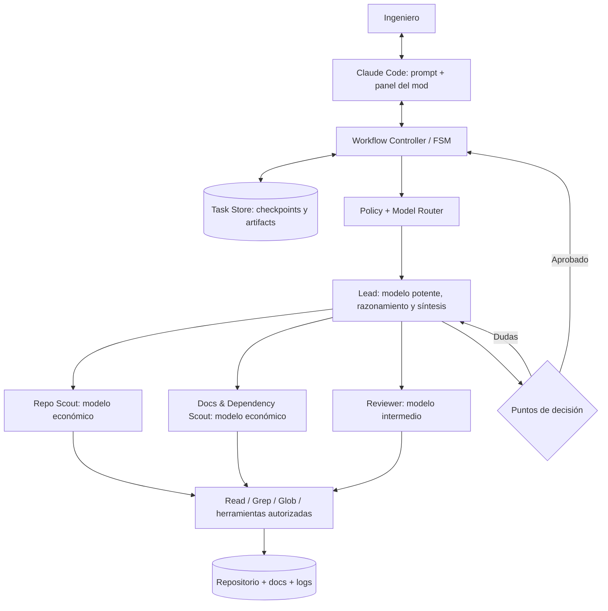
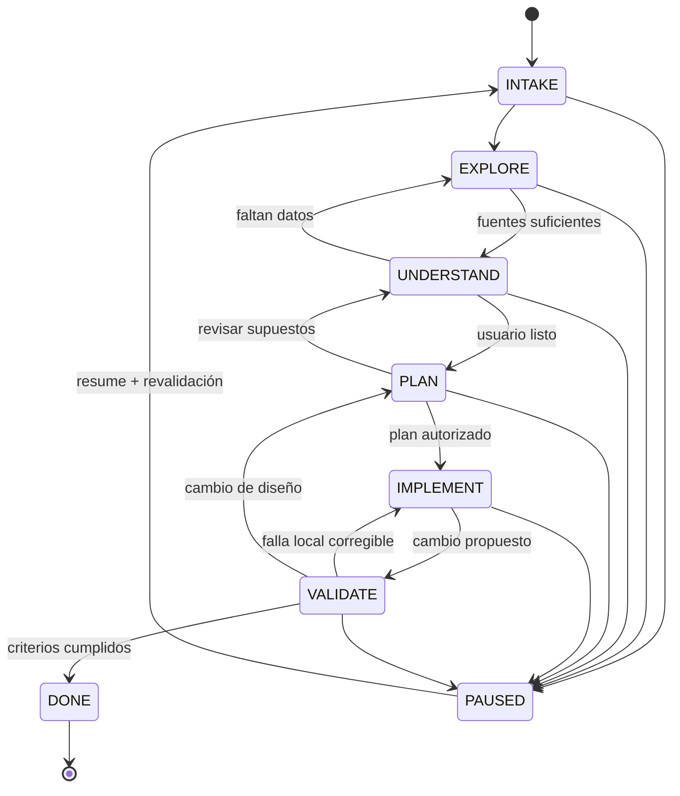

# Engineering Workflow Mod — Product & Technical Spec v0.1

> Original spec as provided by the author, kept verbatim (Spanish). The review,
> corrections, and the decisions taken for v0.0.0 live in
> [SPEC-REVIEW.md](SPEC-REVIEW.md); where they differ, SPEC-REVIEW.md wins.

Fecha: 9 de octubre de 2026
Estado: borrador para diseño
Plataforma objetivo: Claude Code CLI y Claude Desktop (Code tab)
Idea central: convertir tareas de ingeniería en un proceso colaborativo, reanudable, visual y eficiente en uso de modelos.

## 1. Resumen ejecutivo

Un plugin de Claude Code con un mod de interfaz y orquestación que recibe una tarea en lenguaje natural, carga un perfil del proyecto, investiga el repositorio y la documentación con subagentes, ayuda al ingeniero a comprender el sistema, prepara un plan interactivo, implementa cambios con autorización y deja evidencia de validación y un punto de reanudación.

Promesa al usuario: «No necesito saber qué subagentes lanzar ni reconstruir el contexto cada vez. El sistema investiga, me enseña lo relevante, planeamos juntos y ejecutamos con control».

### Principios de diseño

1. Human-in-the-loop: el ingeniero conserva las decisiones sobre alcance, arquitectura y cambios relevantes.
2. Entendimiento antes de ejecución: investigar no equivale a comprender; el sistema debe explicar y contrastar hipótesis.
3. Evidencia rastreable: cada hallazgo importante apunta a archivo/línea, documento, prueba o comando.
4. Persistencia explícita: el estado de la tarea vive fuera de la memoria conversacional de un modelo.
5. Orquestación eficiente: un controlador determinista gestiona estados; el modelo potente razona solo cuando aporta valor.
6. Interfaz visual por defecto, con degradación elegante: panel nativo + mapas de texto; diagramas Mermaid exportables; no depender de un navegador para el MVP.
7. Seguridad por perfil: aplicar restricciones de entorno y proveedor antes de ejecutar, no solo mediante prompts.

## 2. Experiencia del usuario

### Entradas

- Nueva tarea: `/ewm new "Investigar por qué el coverage bin de AXI no se activa"`
- Retomar: `/ewm resume TASK-001`
- Estado: `/ewm status`
- Mapa: `/ewm map`
- Preguntas: `/ewm questions`
- Plan: `/ewm plan`
- Pausar: `/ewm pause`

Estos comandos son diseño propuesto, no comandos actuales de Claude Code.

### Recorrido objetivo

1. El usuario describe la tarea y el objetivo; el sistema detecta repositorio, perfil y contexto existente.
2. El orquestador plantea una estrategia de investigación corta y delega búsquedas con alcance limitado.
3. Presenta un mapa de componentes/dependencias, hipótesis, fuentes, contradicciones y preguntas abiertas.
4. Explica la zona del sistema afectada con un diagrama y una conversación paso a paso; responde dudas y profundiza cuando hace falta.
5. Co-diseña el plan: archivos afectados, alternativas, trade-offs, validación y riesgos.
6. Solicita aprobación del plan para cambios materiales, implementa por incrementos pequeños y muestra diffs.
7. Ejecuta validaciones permitidas, registra resultados, actualiza decisiones y ofrece el siguiente paso.
8. Al pausar, guarda un checkpoint y al retomar muestra un resumen de máximo 60 segundos.

### Panel nativo propuesto

```
┌─ Engineering Workflow ───────────────┐
│ Proyecto: silicon-dv                 │
│ Tarea: TASK-001 · AXI coverage       │
│ Etapa: UNDERSTAND                    │
│                                      │
│ [Explore] → [Understand] → [Plan]    │
│                        [Build] [Test]│
│                                      │
│ Componentes: 6 · Fuentes: 14         │
│ Preguntas abiertas: 3 · Riesgos: 1   │
│ Modelos: Opus (lead), Haiku (search)  │
│                                      │
│ [Ver mapa] [Preguntas] [Aprobar]     │
└──────────────────────────────────────┘
```

Restricción de interfaz: las panes de mods permiten controles de terminal (texto, botones, inputs, etc.); no asumimos soporte nativo para un canvas libre o Mermaid interactivo. El MVP muestra representaciones textuales en el panel y genera archivos .md con diagramas Mermaid para visores compatibles. Un visualizador de grafos enriquecido se deja para una versión posterior.

## 3. Arquitectura de alto nivel



Separación deliberada de responsabilidades:

| Componente | Responsabilidad | Implementación propuesta |
|---|---|---|
| Claude Code | Runtime conversacional, herramientas, permisos base | Producto existente |
| Mod UI | Panel, estado, controles, interceptar eventos pertinentes | TypeScript plugin / function hooks |
| Workflow Controller | Estados, transiciones, aprobaciones, checkpoints, retry | Módulo TypeScript sin dependencia del modelo |
| Workflow Skills | Instrucciones por etapa, formato de evidencia y de planes | `SKILL.md` en el plugin |
| Subagentes | Investigación y revisión con herramientas y modelos limitados | Definiciones `agents/*.md` |
| Model Router | Selección del modelo por coste/complejidad/política | Configuración de agentes + hooks del mod, donde convenga |
| Task Store | Snapshot de cada etapa, decisiones, resultados y reanudación | JSON/YAML + Markdown locales; store del mod para preferencias |
| Tool Adapters (fase posterior) | Repositorios remotos, tickets, CI, simulación, Verdi | MCP/herramientas autorizadas por empresa |

## 4. Máquina de estados



Modo adaptive: una tarea trivial puede condensar exploración/comprensión/plan en una vista breve, pero nunca elimina controles de permisos ni una aprobación que la política requiera. El usuario puede solicitar «deep dive» en cualquier fase.

### Contratos de salida por etapa

| Fase | Entregable / condición para avanzar |
|---|---|
| INTAKE | problema, objetivo, criterios de éxito, repo/perfil, restricciones |
| EXPLORE | mapa de código y dependencias, referencias, hipótesis, preguntas y conflictos |
| UNDERSTAND | explicación interactiva + diagrama + supuestos validados por usuario |
| PLAN | pasos, archivos probables, riesgos, pruebas, alternativas + aprobación |
| IMPLEMENT | diffs acotados, registro de decisiones y desviaciones |
| VALIDATE | pruebas ejecutadas, resultados, brechas y evidencia de cumplimiento |
| DONE | resumen, archivos cambiados, pruebas, cuestiones pendientes, handoff |

Los gates relevantes quedan almacenados con fecha y decisión. «UNDERSTAND» no obliga a hacer un examen: el usuario indica cuándo tiene claridad suficiente.

## 5. Contratos de datos

Perfil (configuración, no estado de tarea):

```yaml
# .ewm/project.yaml  (esquema propuesto, no API oficial)
profile_id: silicon-dv
name: Silicon Design Verification
repositories: ["."]
domains: [systemverilog, uvm, axi, apb]
entrypoints: ["README.md", "docs/"]
policies:
  external_network: deny_by_default
  require_plan_approval: true
  allow_write_in_explore: false
models:
  lead: opus
  search: haiku
  reviewer: sonnet
budgets:
  max_parallel_researchers: 3
  max_research_rounds_without_user_update: 2
```

Tarea (instancia durable):

```json
{
  "id": "TASK-001",
  "project_profile": "silicon-dv",
  "title": "AXI coverage bin investigation",
  "phase": "UNDERSTAND",
  "mode": "deep",
  "repo": {"root": ".", "branch": "feature/axi-coverage", "base_commit": "<sha>"},
  "success_criteria": ["Identificar causa", "Demostrarla con evidencia"],
  "artifacts": ["exploration.md", "system-map.md", "questions.md"],
  "open_questions": ["¿El bin requiere una secuencia no generada?"],
  "decisions": [],
  "approvals": [],
  "next_action": "Comparar secuencias AXI contra definición de coverage",
  "updated_at": "2026-10-09T17:00:00-04:00"
}
```

Layout local sugerido:

```
engineering-workflow-mod/
├── .claude-plugin/plugin.json
├── hooks/{hooks.json,register.ts}
├── src/{controller.ts,router.ts,store.ts,policies.ts,ui.ts}
├── agents/{repo-scout.md,docs-scout.md,reviewer.md}
├── skills/{explore,understand,plan,implement,validate}/SKILL.md
├── schemas/{project.schema.json,task.schema.json}
└── tests/{controller,router,restore,permissions}.test.ts

<workspace>/.ewm/
├── project.yaml
└── tasks/TASK-001/{task.json,exploration.md,system-map.md,
                    questions.md,plan.md,validation.md,decisions.md}
```

Se deben ignorar en Git los artefactos de tarea por defecto, especialmente si contienen código, rutas o logs sensibles. Una instalación personal puede guardarlos fuera del repositorio y apuntar al workspace con un identificador.

## 6. Estrategia de modelos y subagentes

- Lead (Opus o modelo de razonamiento aprobado): descomposición de problema, contradicciones, decisiones, explicación interactiva y síntesis del plan. No se usa para escanear grandes árboles de archivos rutinariamente.
- Repo Scout (Haiku): localizar implementaciones, jerarquías de llamadas, pruebas y referencias de archivo/línea. Solo lectura.
- Docs/Dependency Scout (Haiku): localizar specs/ADRs/configuraciones/dependencias, registrar contradicciones con evidencia. Solo lectura.
- Reviewer (Sonnet): cuestionar hipótesis, evaluar riesgos y revisar diffs antes de validar. Lectura; sin editar directamente.
- Implementer (modelo configurable): la conversación principal o un agente acotado, solo en IMPLEMENT y con permisos explícitos.

Reglas: máximo tres investigadores concurrentes (ajustable); tareas delegadas delimitadas; respuestas estructuradas de máximo N hallazgos con fuentes; deduplicación; escalar a modelo potente al detectar conflicto técnico, baja confianza o decisión con impacto amplio. Medir tokens/uso por fase donde la API lo exponga. Una tarea «barata» no significa degradar la seguridad ni esconder incertidumbre.

Formato de cada hallazgo: claim, evidence[] (path, line/range o doc id), confidence, open_questions[], last_verified_commit. No tratar resumen del agente como hecho sin una fuente comprobable.

## 7. Reanudación confiable

Al `/ewm resume`:

1. Leer tarea persistida, perfil y artefactos; no depender de la conversación anterior.
2. Comparar rama, commit base y archivos clave con la última exploración.
3. Si el repo cambió, marcar evidencia como stale y actualizar solo las zonas afectadas.
4. Mostrar «dónde estábamos», acuerdos aprobados, preguntas abiertas y siguiente acción.
5. Pedir decisión únicamente cuando de verdad cambie el alcance o aparezca una contradicción.

Garantía de producto: después de reiniciar Claude Code, una tarea conserva fase, decisiones, evidencia y próximos pasos. Reanudar no implica repetir automáticamente operaciones con efectos secundarios.

## 8. Seguridad y entorno empresarial

- Gate previo: verificar que la herramienta, el proveedor/modelo, los repositorios y las rutas son autorizados por la organización. No asumir que «guardado local» significa que el código no se envía al proveedor del modelo.
- No exfiltración: redes externas deshabilitadas por defecto en perfiles sensibles; no sincronizar artefactos ni telemetría fuera de políticas aprobadas.
- Sin permisos automáticos peligrosos: no autorizar escrituras, ejecución destructiva, push ni acceso a secretos por cuenta del mod. Aplicar políticas también a nivel organizacional/permisos de Claude Code.
- Audit trail: registrar aprobación, herramienta, efecto, commit, resultado de prueba y excepciones sin conservar credenciales.
- Aislamiento: separar configuraciones y datos de Microsoft vs. proyectos personales. No replicar material corporativo en el repositorio personal del plugin.

Nota técnica: los mods tienen permisos del usuario y no están aislados por un sandbox; el propio mod forma parte de la superficie de confianza. Los plugins corporativos deben pasar revisión antes de instalarse.

## 9. MVP y plan de entregas

### MVP — una tarea completa, un repositorio

Incluye:

- Plugin con mod TypeScript, `/ewm new`, `/ewm resume`, `/ewm status` y un panel sencillo.
- Estado persistente, fases y dos gates: pasar a implementación y aceptar cierre.
- Tres subagentes: repo scout, docs scout, reviewer, con modelos configurables.
- Skills por etapa, evidencia con rutas/líneas, preguntas abiertas, plan y salida de Mermaid.
- Revisión explícita de diff y validación con comandos permitidos.
- Perfil de proyecto básico y fallback en texto cuando no aparece el panel.

Excluye por ahora: editor de grafos drag-and-drop; indexación semántica permanente; sincronización multiusuario; sistema de tickets externo; introspección de simulaciones Verdi/UVM automática; múltiples repos en simultáneo; soporte universal de proveedores/modelos.

### Iteraciones posteriores

- v0.2: clasificación automática quick/deep, router de costes basado en métricas, detección de stale evidence y exploración incremental.
- v0.3: adaptadores de tickets/CI, mapa de dependencias enriquecido y perfil Silicon DV con lectura de reportes de simulación/coverage (solo en entornos autorizados).

### Criterios de aceptación del MVP

1. Crear TASK-001, explorar una base de código y generar mapa + 5 hallazgos con fuentes.
2. Discutir un hallazgo sin que el agente implemente antes de aprobar el plan.
3. Pausar, cerrar la sesión y reanudar con el estado y las decisiones intactos.
4. Mostrar al menos una investigación realizada por un modelo económico configurado y confirmar cuál se usó.
5. Validar un cambio pequeño, adjuntar resultado y mostrar un handoff completo.
6. Intentar una herramienta no permitida en fase EXPLORE y confirmar que se bloquea sin depender exclusivamente de un prompt.

## 10. Decisiones propuestas y cuestiones abiertas

Decisiones sugeridas ahora: TypeScript; plugin/mod como envolvente; controlador determinista; artefactos en Markdown + JSON; diagramas Mermaid; perfiles independientes de tareas; no base de datos/vector DB en MVP.

Preguntas para refinar más adelante: ¿cómo identificar automáticamente el repo en un monorepo? ¿qué herramienta corporativa está aprobada para Microsoft? ¿qué gate exige aprobación incluso en quick mode? ¿qué nivel de diagramación es viable según el terminal? ¿preferir almacenamiento junto al repo o bajo el home local? ¿qué señales harán escalar a Opus?

### Referencias técnicas verificadas el 9 de octubre de 2026

- Mods overview: https://code.claude.com/docs/en/plugins/mods/overview
- Mods UI: https://code.claude.com/docs/en/plugins/mods/interface
- Mods API: https://code.claude.com/docs/en/plugins/mods/api
- Subagents & model selection: https://code.claude.com/docs/en/sub-agents
- Skills: https://code.claude.com/docs/en/skills
