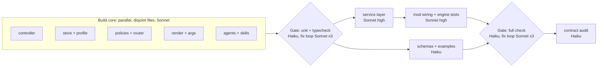
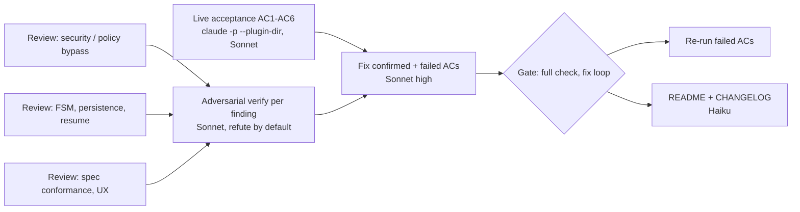

# Build workflow for v0.0.0

How v0.0.0 was produced: an Opus orchestrator owning contracts, review and
release; Sonnet and Haiku workers doing all implementation, testing and
documentation through two Claude Code Workflow runs.

## Roles

| Role | Model | Owns |
|---|---|---|
| Orchestrator | Opus | Spec review, decision register, `src/types.ts`, `tests/support/memory-io.ts`, ARCHITECTURE.md contracts, workflow scripts, deliverable review, release. Writes no feature code. |
| Builders | Sonnet | `src/*` modules + unit tests, service layer, mod wiring + engine tests, fixes, skills/agents content, live acceptance run, adversarial review. |
| Mechanics | Haiku | Gate runs (test/validate/typecheck reporting), JSON schemas + examples, contract-conformance audit, README/CHANGELOG. |

## Run 1: Build

File ownership is disjoint inside each parallel stage, so no worktrees are
needed. Each builder runs only its own unit tests while others are mid-edit.

## Run 2: Harden

The orchestrator reviews Run 1's output before launching Run 2, and Run 2's
output before release.

## Success metrics

| ID | Metric | Target | Measured by |
|---|---|---|---|
| M1 | Unit tests | 100% pass | `npm run test:unit` |
| M2 | Engine (mod) tests | 100% pass | `claude plugin test .` |
| M3 | Plugin validation | passes, 0 errors | `claude plugin validate .` |
| M4 | Type safety | 0 errors, both configs | `npm run typecheck` with engine 2.1.296 types |
| M5 | Contract conformance | every export in ARCHITECTURE.md present with its signature | Haiku audit + `tsc` |
| M6 | FSM coverage | every edge in `EDGES` and every non-edge from each active phase asserted; both gates tested approve, reject, and stale-hash | `tests/unit/controller.spec.ts` |
| M7 | Policy coverage | each matrix rule (1-9) has >= 1 allow and >= 1 deny test; >= 40 Bash cases including >= 15 bypass attempts (`;`, `$(..)`, backticks, redirects, `find -exec`, `sed -i`, `git -c`, quoting tricks) that must not classify as read_only | `tests/unit/permissions.spec.ts` |
| M8 | Acceptance criteria | 6/6 covered by automated tests and 6/6 shown live with commands and outputs | test files + `docs/ACCEPTANCE.md` |
| M9 | Adversarial review | 0 open confirmed high/critical findings | Run 2 verify stage |
| M10 | Inert by default | no active task -> 0 denials, model tools deferred | engine tests |
| M11 | Model routing proof | live run records >= 1 scout spawn on the profile's search model (haiku) in `task.json.agent_usage` | `docs/ACCEPTANCE.md` |
| M12 | Resume brief | <= 180 words | unit test |
| M13 | Model mix | 100% of implementation tokens on Sonnet/Haiku | workflow labels |

## Gate definitions

- **Gate A (build)**: `npm run test:unit` and `npm run typecheck` clean.
- **Gate B (full)**: `npm run check` clean (unit, validate, engine tests, typecheck).
- A gate failing after 3 fix rounds stops the run and returns to the orchestrator.

## Release checklist (v0.0.0)

- [ ] M1-M13 met, or each miss written up in the PR with a reason
- [ ] `docs/ACCEPTANCE.md` complete
- [ ] README install line: `/plugin install ewm --marketplace esola-thomas/claude_code_engineering_workflow_mod`
- [ ] CHANGELOG entry for 0.0.0
- [ ] PR merged, CI green, tag `v0.0.0`
