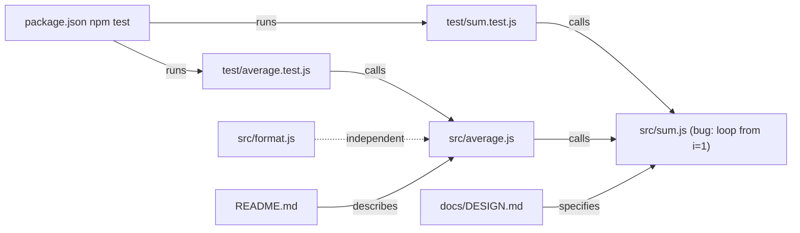

# System map - TASK-001: Find why average() returns the wrong value

Updated: 2026-10-10T00:54:47.232Z

## Text map

```text
average.js -> calls sum.js (mean = sum / length; empty list returns 0)
sum.js: loop starts at i=1, skips first element (root cause)
format.js: independent, presentation only
test/average.test.js and test/sum.test.js: expect correct values, currently failing
package.json: npm test runs node --test test/*.test.js
docs/DESIGN.md: invariants say sum includes every element
README.md: describes modules and npm test
```

## Components

- src/average.js
- src/sum.js
- src/format.js
- test/average.test.js
- test/sum.test.js
- package.json
- docs/DESIGN.md
- README.md

## Diagram


