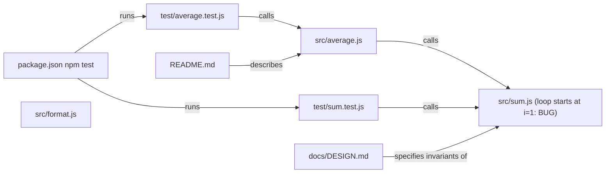

# System map - TASK-001: Find why average() returns the wrong value

Updated: 2026-10-09T23:30:37.823Z

## Text map

```text
average.js -> calls sum.js for the addition, then divides by length
sum.js: loop starts at i=1, so numbers[0] is skipped (root cause)
test/average.test.js and test/sum.test.js both call into this code
docs/DESIGN.md: sum must include the first element; average*length == sum
README.md: documents the modules and npm test
package.json: npm test = node --test test/*.test.js
format.js: independent, presentation only
```

## Components

- src/average.js
- src/sum.js
- src/format.js
- test/average.test.js
- test/sum.test.js
- docs/DESIGN.md
- README.md
- package.json

## Diagram


